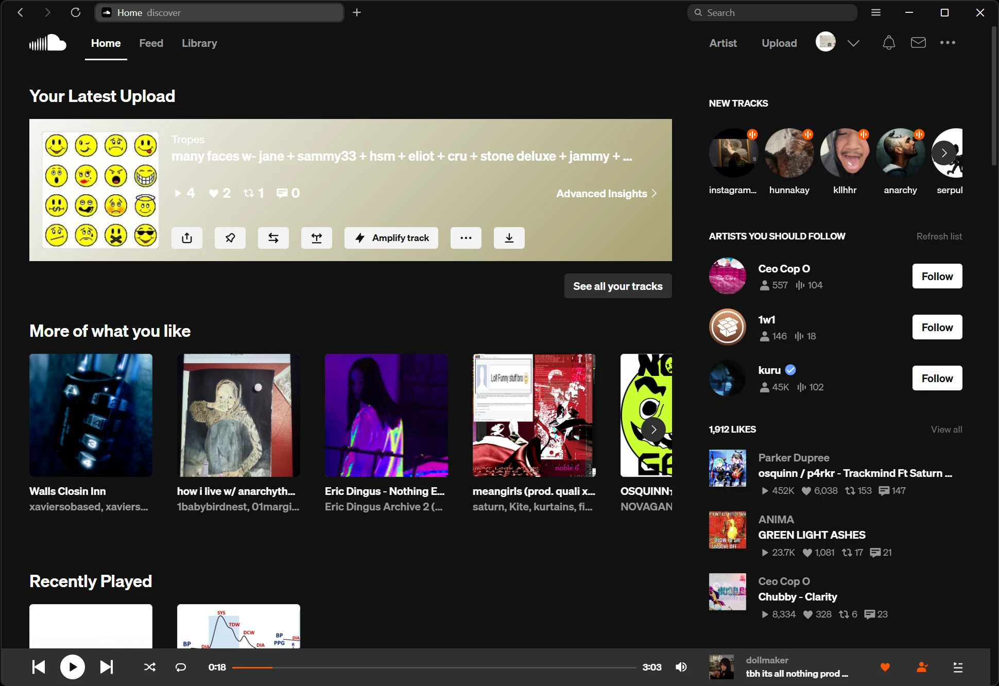
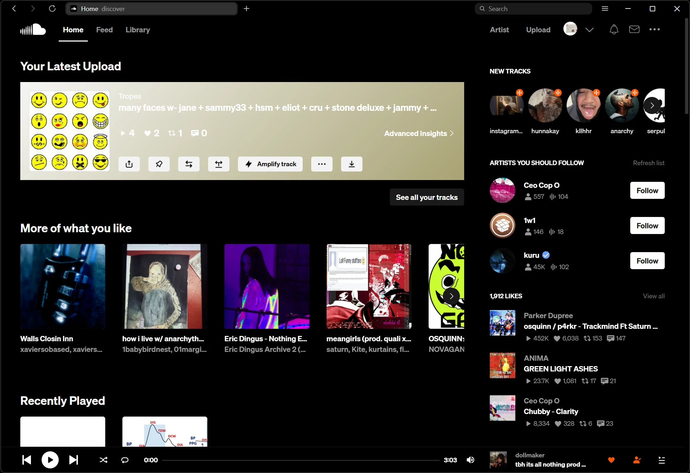
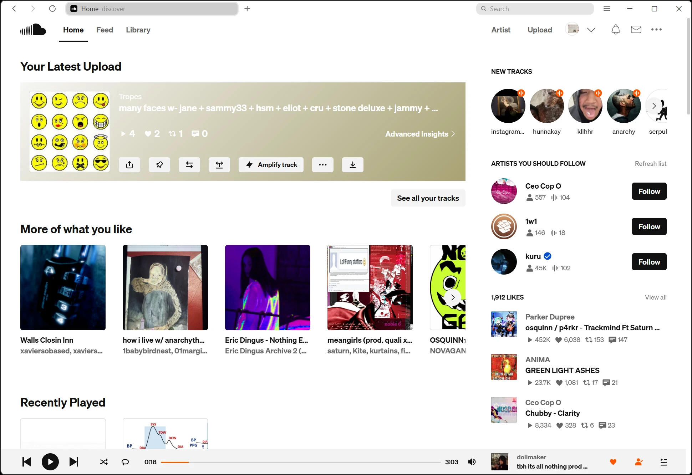

<div align="center">


# sc-desktop

A desktop app for SoundCloud, for macOS, Windows and Linux.

</div>

Started as a fork of [richardhbtz/soundcloud-rpc](https://github.com/richardhbtz/soundcloud-rpc) and has since grown
into its own thing.



| OLED theme                                                                             | Light mode                                                                                |
| -------------------------------------------------------------------------------------- | ----------------------------------------------------------------------------------------- |
|  |  |

## What it does

- Tabs, with an address bar in the active tab
- Downloads tracks, albums and playlists with [yt-dlp](https://github.com/yt-dlp/yt-dlp)
- Discord Rich Presence, Last.fm scrobbling and webhooks
- Blocks ads and hides SoundCloud's promos and Go+ upsells
- Dark mode, [custom themes](docs/CUSTOM_THEMES.md) and [plugins](docs/PLUGINS.md)
- More than one account
- Go+ playback
- Swipe back and forward on macOS
- Proxy support

## Install

Grab a build from the [releases](https://github.com/elricfd/sc-desktop/releases) page.

If macOS says the app is damaged, clear the quarantine flag:

```bash
xattr -dr com.apple.quarantine /Applications/SoundCloud.app
```

On Linux, make the AppImage executable and run it. It adds its own desktop entry the first time. The tray works on KDE
as is; GNOME needs a tray extension.

```bash
chmod +x soundcloud-*-linux.AppImage
./soundcloud-*-linux.AppImage
```

### Downloads

Downloads need yt-dlp (`brew install yt-dlp`, `winget install yt-dlp` or `pip install yt-dlp`) and, for most tracks,
ffmpeg. If the app can't find yt-dlp, set its path in Settings, where you can also change the file and folder names.

SoundCloud won't hand out DRM-protected tracks, so the app looks those up on YouTube instead (lower quality, and the
downloads list says so). With [deemix](https://pypi.org/project/deemix/) set up, it tries Deezer first.

### Updates

The app updates itself: it downloads new releases in the background and installs them when you quit (on Windows and
Linux it offers to restart). You can turn this off in Settings. Builds older than 1.2.1 on macOS need one update by
hand.

### Logs

If something freezes or crashes, the log helps. It never leaves your computer.

- Windows: `%APPDATA%\sc-desktop\logs\main.log`
- macOS: `~/Library/Logs/sc-desktop/main.log`
- Linux: `~/.config/sc-desktop/logs/main.log`

## Shortcuts

Settings are under the menu button at the top right.

| Key                                | Action                  |
| ---------------------------------- | ----------------------- |
| `F1`                               | Settings                |
| `Ctrl/Cmd + T`                     | New tab                 |
| `Ctrl/Cmd + W`                     | Close tab               |
| `Ctrl + Tab`, `Ctrl + Shift + Tab` | Next and previous tab   |
| `Ctrl/Cmd + L`                     | Edit the address        |
| `Ctrl/Cmd + R`                     | Reload                  |
| `Ctrl/Cmd + B`                     | Back                    |
| `Ctrl/Cmd + F`                     | Forward                 |
| `Ctrl/Cmd + =`, `-`, `0`           | Zoom in, out, and reset |

## Building

You need [Node.js](https://nodejs.org/).

```bash
npm install
npm run dev          # run from source
npm run build-mac    # or build-win, build-linux-appimage, build-linux-deb
```

`npm test` runs the tests and `npm run lint` runs ESLint.

### Go+ tracks

Go+ tracks are DRM-protected and play through Widevine, which on macOS and Windows only works in a build signed by
castlabs (free). Without it the app runs fine and plays free tracks, but Go+ tracks stall or skip, so check that first
if paid tracks won't play.

```bash
pip install --upgrade castlabs-evs
python -m castlabs_evs.account signup

EVS_USERNAME=you EVS_PASSWORD=secret npm run build-mac
```

`STRICT_VMP_SIGNING=true` makes the build fail if signing doesn't work. Linux doesn't need it.

## Credits

Based on [soundcloud-rpc](https://github.com/richardhbtz/soundcloud-rpc) by Richard Habitzreuter.

## License

[MIT](./LICENSE)
